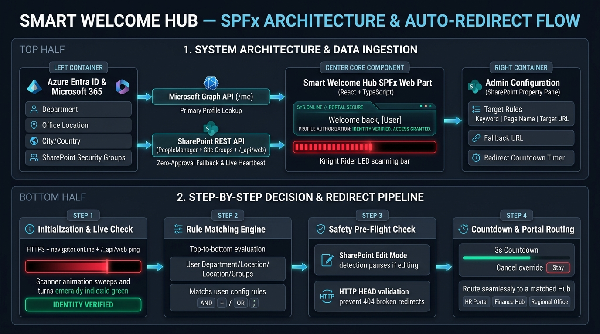
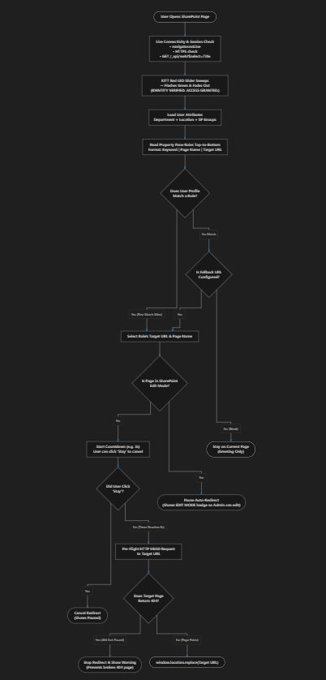
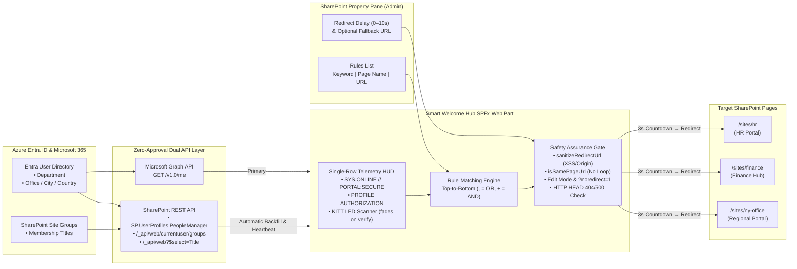
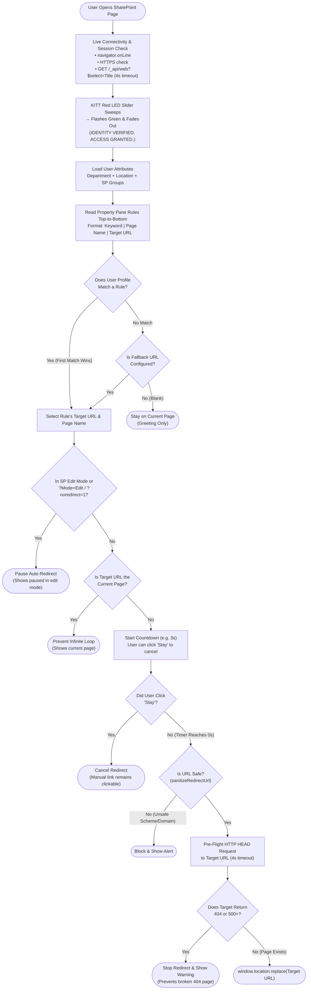

# Smart Welcome Hub — Architecture & Auto-Redirect Flow

## Visual Architecture & Flow Overview

---

## Step-by-Step Decision Flowchart Image

---

## 1. System Architecture Diagram (Mermaid)

---

## 2. Step-by-Step Decision & Safety Flowchart (Mermaid)

