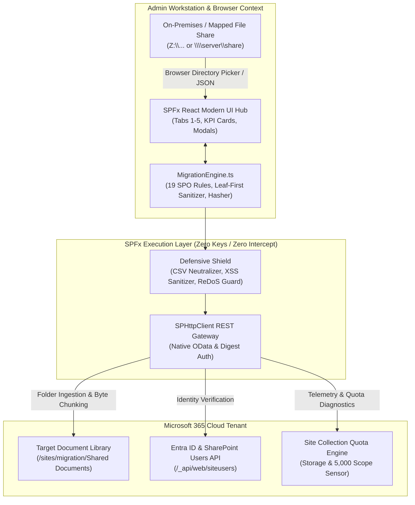
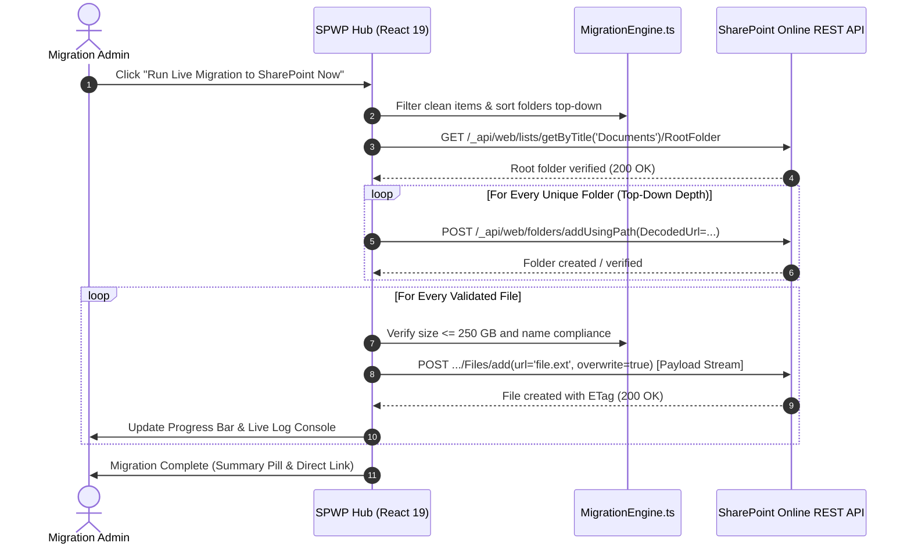

# SharePoint Online Migration Manager & Readiness Hub (SPWP)

[](https://learn.microsoft.com/sharepoint/dev/spfx/sharepoint-framework-overview)
[](https://react.dev)
[](https://www.typescriptlang.org)
[](https://github.com/FuturisticLab/SPWP)
[](https://github.com/FuturisticLab/SPWP)
[](https://learn.microsoft.com/en-us/office365/servicedescriptions/sharepoint-online-service-description/sharepoint-online-limits)

A production-grade **SharePoint Framework (SPFx)** enterprise application that runs directly within modern SharePoint Online pages. It delivers end-to-end migration discovery, deterministic leaf-first character remediation, NTFS ACL permission auditing, 5,000 unique scope analysis, real-time throttling anomaly telemetry, and a **zero-script live in-browser migration runner** that ingests multi-gigabyte file hierarchies straight into SharePoint document libraries under a **Strict Security Architecture** (no stored credentials, API keys, or external daemon dependencies).

---

## 📑 Table of Contents
- [Executive Overview](#-executive-overview)
- [System Architecture & Data Flow](#-system-architecture--data-flow)
- [Technology Stack](#-technology-stack)
- [The 5-Stage Migration Lifecycle](#-the-5-stage-migration-lifecycle)
  - [Stage 1: Pre-Flight Assessment & Inventory](#stage-1-pre-flight-assessment--inventory)
  - [Stage 2: Deterministic Leaf-First Remediation](#stage-2-deterministic-leaf-first-remediation)
  - [Stage 3: Permissions & Identity Alignment](#stage-3-permissions--identity-alignment)
  - [Stage 4: SharePoint & Azure Ingestion Pipeline](#stage-4-sharepoint--azure-ingestion-pipeline)
  - [Stage 5: Anomaly Monitor & Live Telemetry](#stage-5-anomaly-monitor--live-telemetry)
- [Official Microsoft Limits & Compliance Rules](#-official-microsoft-limits--compliance-rules)
- [Strict Security Architecture](#-strict-security-architecture)
- [Installation & Local Development](#-installation--local-development)
- [Production Build & Packaging](#-production-build--packaging)
- [Tenant Deployment & Page Placement](#-tenant-deployment--page-placement)
- [Publishing to GitHub (FuturisticLab/SPWP)](#-publishing-to-github-futuristiclabspwp)
- [License & Authors](#-license--authors)

---

## 🎯 Executive Overview

Migrating legacy Windows file servers, mapped network shares (`Z:\...`), and UNC directories (`\\server\share`) into **Microsoft 365 SharePoint Online** is frequently obstructed by:
1. Prohibited characters (`" * : < > ? / \ |`), Win32 backstage folder semicolons (`;`), Office temporary locks (`~$*`), and reserved device names (`CON`, `PRN`, `AUX`, `NUL`, `COM1-9`, `LPT1-9`).
2. Deep folder hierarchies exceeding the official **400 decoded character** URL ceiling.
3. Complex on-premises NTFS ACLs exceeding SharePoint's strict **5,000 unique security scope threshold** per library.
4. Operational friction requiring Global Admin rights, complex Azure PowerShell modules, or expensive third-party agents.

**SPWP (SharePoint Online Migration Manager)** eliminates these roadblocks by running natively inside the browser where the user is already authenticated. Testing and production migrations can be executed against **any** SharePoint site collection or sandbox library where the operator has standard Member or Contribute rights.

---

## 🏗 System Architecture & Data Flow



### In-Browser Recursive Ingestion Sequence



---

## 💻 Technology Stack

| Layer | Component | Version / Standard | Purpose |
| :--- | :--- | :--- | :--- |
| **Framework** | SharePoint Framework (SPFx) | `v1.20.2` | Native Microsoft 365 client-side extension |
| **View Engine** | React & React-DOM | `19.0.0` / `17.0.1` | Component lifecycle, hooks, and responsive UX |
| **Language** | TypeScript | `v5.8.3` | Strict type safety, interface contracts, zero any-casts |
| **Build Tooling** | Rushstack Heft & Webpack | `v5.105.4` | High-speed production bundling and tree-shaking |
| **Linter & Style** | ESLint & Sass Modules | `v9.37.0` | Modular Scoped CSS, 0 errors, 0 warnings policy |
| **Protocol** | SPHttpClient | OData v3/v4 | Direct session REST communication without client secrets |
| **Integrity** | Web Crypto API | SHA-256 | Bit-level cryptographic verification before/after transfer |
| **Companion** | PowerShell & WPF | `7.4` / `5.1` | Native desktop counterpart for sysadmin batch pipelines |

---

## 🚀 The 5-Stage Migration Lifecycle

### Stage 1: Pre-Flight Assessment & Inventory
* **Network & Local Ingestion:** Direct folder consumption via browser Directory Picker API (`webkitdirectory`) or offline ingestion of `SPO_Inventory_Assessment_*.json`.
* **19-Rule Compliance Audit:** Evaluates items against prohibited characters, trailing periods/spaces, Win32 reserved device names, and path ceilings.
* **Cryptographic Hashing:** Computes on-demand SHA-256 checksums for cryptographic pre/post-migration integrity audits.
* **1-Click Artifact Exports:** Generates itemized `CSV`, `JSON`, and visual hierarchical `Directory_Tree.txt` representations.

### Stage 2: Deterministic Leaf-First Remediation
* **Bottom-Up Sanitization Precedence:** Renames deepest child files before parent folders to eliminate path dislocation errors.
* **Step 0 Safety Mirror:** Automatically integrates a multi-threaded Robocopy mirror (`/E /COPY:DAT /MT:8`) to guarantee source data safety before modifications.
* **Automated URL Shortening:** Intelligently truncates deep path segments while preserving file extensions and unique disambiguation suffixes if the URL exceeds 400 characters.
* **100% Reversible Rollback:** Generates companion `Undo_Remediation.ps1` utilizing `-LiteralPath` syntax to revert all renamed items in reverse order.

### Stage 3: Permissions & Identity Alignment
* **NTFS ACL Inspection:** Discovers security principals, translates Access Control Entries into SharePoint roles (Full Control $\rightarrow$ *Owner*, Modify $\rightarrow$ *Member*, Read $\rightarrow$ *Visitor*).
* **5,000 Unique Scope Detection:** Warns if unique folder permissions threaten SharePoint's 5,000 unique scope query limit.
* **Entra ID Translation:** Maps on-premises `DOMAIN\username` accounts into Microsoft 365 User Principal Names (`user@tenant.onmicrosoft.com`).
* **Live Site User Verification:** Validates proposed UPNs in real-time against `/_api/web/siteusers`.

### Stage 4: SharePoint & Azure Ingestion Pipeline
* **Zero-Script Live In-Browser Runner:** Replicates multi-level folder trees top-down and uploads files in stream chunks directly into the target document library.
* **Tenant Flexibility:** Supports migration into **any** SharePoint Online site collection where you have standard contributor permissions.
* **250 GB Wave Batch Migration Benchmark:** Simulates multi-wave enterprise migrations measuring real throughput (MB/s), projected GB/hour, and HTTP 429 throttling delays.
* **Companion Script Automation:** Generates tailored `Invoke-SPOMigrationPipeline_*.ps1` scripts for unattended server-side batch migrations.

### Stage 5: Anomaly Monitor & Live Telemetry
* **Real-Time Health Sensors:** Proactively monitors destination storage quotas, remaining URL path headroom, and unique permission scope density.
* **Throttling Diagnostics:** Features intelligent detection of HTTP 429 / 503 responses with automatic exponential backoff recommendations (`Retry-After`).
* **Diagnostic Audit Console:** In-memory streaming console with timestamps, severity filters (`ERROR`, `WARN`, `SUCCESS`, `INFO`), and JSON event export.

---

## 📏 Official Microsoft Limits & Compliance Rules

SPWP is engineered to enforce the official limits documented by Microsoft Learn:

| Limit Dimension | Official Microsoft Threshold | SPWP Engine Enforcement |
| :--- | :--- | :--- |
| **Max Individual File Upload** | **250 GB** (Document Libraries & OneDrive) | Configurable by profile (250 MB dev ceiling / 250 GB prod ceiling) |
| **List Item Attachment Ceiling** | **250 MB** | Items destined for list attachments flagged if > 250 MB |
| **Max URL Path Length** | **400 Decoded Characters** | Proactively flagged and automatically shortened in Stage 2 |
| **Prohibited File Characters** | `" * : < > ? / \ \|` | Deterministically substituted with `_` or custom replacement char |
| **Win32 Backstage Folder Semicolon** | `;` (Causes save failures in Win32 Office) | Flagged and sanitized in folder names |
| **Invalid Substrings & Prefixes** | `..`, `~$*`, `.tmp`, `.lock`, `_vti_`, `forms` | Automatically flagged as migration blockers |
| **Prohibited Sync Characters** | Leading `\u309B` (゛) or `\u1018` (ဧ) | Detected and stripped during remediation |
| **Reserved Win32 Device Names** | `CON, PRN, AUX, NUL, COM1-9, LPT1-9` | Renamed with disambiguation prefixes |
| **Unique Permission Scopes** | **5,000 per Document Library / List** | Dedicated Stage 3 sensor flags libraries exceeding threshold |

---

## 🛡 Strict Security Architecture

SPWP adheres to enterprise-grade defensive security standards:
1. **Zero Secret Persistence:** Operates 100% within the user's active, authenticated browser session via SharePoint's built-in `SPHttpClient`. No Azure Storage keys, passwords, or client secrets are requested, stored, or transmitted.
2. **Defensive CSV Formula Neutralization:** All spreadsheet exports neutralize potential Dynamic Data Exchange (DDE) injection vectors by prepending `'` to fields starting with `=`, `+`, `-`, `@`, `\t`, or `\r`.
3. **PowerShell Script Injection Defense:** Script generators (`generateRemediatePs1`, `generateUndoRemediationPs1`, `generateBackupSharePs1`) use strict single-quote escaping and `-LiteralPath` parameters to prevent command injection from malicious file paths.
4. **OData & Single-Quote Escaping:** All SharePoint REST endpoints safely encode single quotes (`''`) in library titles and folder names.
5. **ReDoS Immunity:** Regular expressions are static and strictly bounded to prevent catastrophic backtracking.

---

## 📦 Installation & Local Development

### Prerequisites
* [Node.js](https://nodejs.org/) (LTS v18 or v20 recommended)
* Standard Microsoft 365 Developer or Business Tenant

### 1. Clone the Repository
```bash
git clone https://github.com/FuturisticLab/SPWP.git
cd SPWP/spo-migration-hub
```

### 2. Install Dependencies
```bash
npm install
```

### 3. Start Local Workbench Server
```bash
npm run serve
```
Open your browser to:
`https://{your-tenant}.sharepoint.com/sites/{your-site}/_layouts/15/workbench.aspx`

---

## 🔨 Production Build & Packaging

To compile a clean, 0-warning production package:

```bash
# Clean, lint, test, and bundle
npm run build
```

This runs:
1. `heft test --clean --production`: Cleans build directories, validates SCSS modules, and compiles TypeScript.
2. `heft package-solution --production`: Bundles client assets and packages the `.sppkg` solution file into:
   ```
   sharepoint/solution/spo-migration-hub.sppkg
   ```

---

## 🚀 Tenant Deployment & Page Placement

1. **Deploy to App Catalog:**
   * Navigate to your **SharePoint Tenant App Catalog** (`https://{your-tenant}.sharepoint.com/sites/appcatalog/AppCatalog`).
   * Drag and drop `spo-migration-hub.sppkg` into the **Apps for SharePoint** library.
   * Check **"Enable this app and add it to all sites"** (or deploy to specific site collections) and click **Enable App**.

2. **Add to Site Page:**
   * Open any SharePoint modern page and click **Edit** (top right).
   * Click the **+** (Add web part) icon.
   * Search for **"SharePoint Online Migration Manager & Readiness Hub"**.
   * Publish the page.

---

## 📤 Publishing to GitHub (FuturisticLab/SPWP)

To publish this codebase directly to your newly created repository:

```bash
# Navigate to the web part directory
cd "c:\Users\jmarc\Desktop\FirebaseMigration\SharePoint WebPart"

# Initialize Git
git init
git branch -M main

# Add the remote repository
git remote add origin https://github.com/FuturisticLab/SPWP.git

# Stage and commit all project files
git add .
git commit -m "feat: initial commit of SharePoint Online Migration Manager & Readiness Hub (SPWP) v1.0"

# Push to GitHub
git push -u origin main
```

---

## 📄 License & Authors

Developed and maintained by **FuturisticLab**. Licensed under the **MIT License**.
Contributions, issue reports, and pull requests are welcome at [FuturisticLab/SPWP](https://github.com/FuturisticLab/SPWP).
